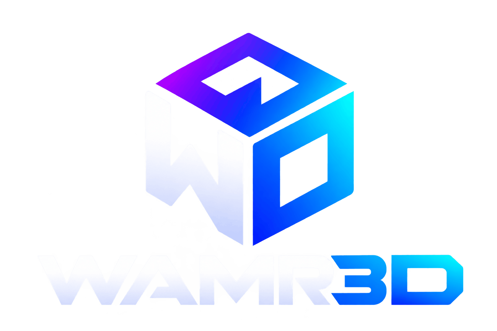

# WAMR3D

**Unlock your imagination without limits.** WAMR3D is a high-performance 3D engine that runs as native WebAssembly in the browser: a Rust core, its own WebGPU renderer and the three.js API you already know.

**X[number] faster than three.js and other browser-based 3D libraries.** *(Placeholder: the figure will be set from published benchmarks.)*

WAMR3D provides a WebAssembly scene graph, transforms, cameras, geometry processing, culling and draw ordering, plus a separate WebGPU renderer. Drive it from JavaScript through classes that follow three.js conventions or through batched calls for large scenes. The object API keeps user-facing transforms in JavaScript and synchronizes them with the engine in batches. Behaviour is checked against three.js value by value and pixel by pixel.

It has no runtime dependencies and draws with its own WebGPU renderer, switching to a native WebGL 2 renderer where WebGPU is missing: meshes, lines, line loops, points, sprites and instanced meshes; basic, Lambert, Phong, toon, normal and standard materials with emissive light; colour, normal, roughness, metalness, emissive, alpha and ambient-occlusion maps and alpha testing; up to 16 directional, point and spot lights; directional and spot shadows with PCF; image-based lighting from `scene.environment` or `envMap` (equirectangular, prefiltered like three.js's PMREM); texture backgrounds; tone mapping; render targets; transparency; and fog. The standard material follows three.js's lighting model. Point-light shadows, area lights, cube textures and post-processing are not part of it yet; see [Status](#status) for the full list. The repository is ahead of the published 0.3.0 package: environment maps, backgrounds, texture maps, the extra materials, line loops and `LOD` are in the local build ([STATUS.md](STATUS.md)).

## Why try it

- **Faster scene updates where it counts.** Updating 10,000 animated objects (rotations, world matrices, camera) took a median 1.6 ms in WAMR3D against 4.5 ms in three.js at 1920×1080, in Chrome on the same machine with the same scene and the same renderer. At 2,000 objects it was 0.4 ms against 0.6 ms.
- **Same results as three.js.** Over 7,600 reference cases generated from the three.js source are replayed against the Rust code. Individual operations agree to about one part in a million.
- **Explicit low-level ownership.** The handle-based API stores objects in WebAssembly memory and uses explicit destruction; stale handles cannot refer to a different object. The three.js-style object API keeps transforms in JavaScript and releases engine objects when their JavaScript objects are collected.
- **Zero-copy low-level geometry access.** Read and write geometry attributes through typed-array views straight over engine memory. The compatibility API exposes copies for mutable attribute arrays.
- **Its own WebGPU and WebGL 2 renderers.** In the showcase scene with 10,000 separate animated meshes at 1920×1080, WAMR3D ran at 59 fps on WebGPU (13.3 ms of draw submission per frame) and 54 fps on its WebGL 2 renderer; three.js ran at 37 fps with its WebGL renderer (21.6 ms) and 12 fps with its WebGPU renderer (78.3 ms). With 50,000 instanced bodies in a four-level scene graph, WAMR3D ran at 55 to 60 fps (12 to 13 ms of scene update) against 20 to 21 fps for three.js (40 to 45 ms). Summed over all 28 showcase configurations (four resolutions), WAMR3D's frame rate is 1.3× that of the faster three.js renderer in each, with 2.2× less CPU time per frame. One run per configuration on one machine; raw logs in [`bench/results/2026-10-15-webgl/`](bench/results/2026-10-15-webgl/) (the comparison scene was not run at 3840×2160), tables on the website's benchmarks page.
- **Small and free.** The current SIMD WebAssembly module is about 567 KiB, shaders for both backends included. Nothing to pay, nothing else to install at run time.

What it is not: a complete replacement for three.js. Calls that do very little work (a single vector operation, one property at a time) are *slower* than plain JavaScript, because crossing into WebAssembly has a fixed cost. WAMR3D wins when you batch. The numbers for both cases are in [`bench/results/2026-10-14/`](bench/results/2026-10-14/).

## Install

```
npm install wamr3d
```

The package is on npm: <https://www.npmjs.com/package/wamr3d>. To build it from source instead, see [Build](#build).

## Quick look

```js
import * as WAMR3D from 'wamr3d/compat';

await WAMR3D.init();

const scene = new WAMR3D.Scene();
const camera = new WAMR3D.PerspectiveCamera( 50, innerWidth / innerHeight, 0.1, 100 );
camera.position.set( 3, 2, 5 );
camera.lookAt( 0, 0, 0 );

const cube = new WAMR3D.Mesh( new WAMR3D.BoxGeometry(), new WAMR3D.MeshLambertMaterial( { color: 0x4f8cff } ) );
scene.add( cube, new WAMR3D.DirectionalLight( 0xffffff, 2 ), new WAMR3D.HemisphereLight( 0xbfd4ff, 0x30281e, 1 ) );

const renderer = new WAMR3D.WebGPURenderer( { antialias: true } );
await renderer.init();
renderer.setSize( innerWidth, innerHeight );
document.body.appendChild( renderer.domElement );

renderer.setAnimationLoop( ( time ) => {

	cube.rotation.y = time / 1000;
	renderer.render( scene, camera );

} );
```

The same engine through the low-level API, without classes:

```js
import { init, World } from 'wamr3d';

await init();

const world = new World();
const scene = world.createObject();
const arm = world.createObject();
const hand = world.createObject();
world.add(scene, arm);
world.add(arm, hand);

world.setPosition(arm, 10, 0, 0);
world.setRotation(arm, 0, 0, Math.PI / 2, 'XYZ');
world.setPosition(hand, 1, 0, 0);

world.updateMatrixWorld(scene, false);
console.log(world.matrixWorld(hand)); // Float32Array(16), column-major
```

## Coming from three.js

For the classes WAMR3D has, change the import, initialize once, and use the WebGPU renderer:

```diff
- import * as THREE from 'three';
+ import * as THREE from 'wamr3d/compat';
+ await THREE.init();

- const renderer = new THREE.WebGLRenderer( { antialias: true } );
+ const renderer = new THREE.WebGPURenderer( { antialias: true } );
+ await renderer.init();
```

`scene.add( mesh )`, `mesh.position.set( 1, 2, 3 )`, `mesh.rotation.y += 0.01`, `camera.lookAt( 0, 0, 0 )`, `raycaster.intersectObjects( scene.children )` and chained math keep working as written. A test runs one such script against both libraries and compares every number.

Setting `position`, `rotation` and `scale` does not call into WebAssembly: the object API keeps them in JavaScript and sends every change to the engine in one batch per frame.

**[Read the full migration guide →](MIGRATION.md)** It lists which classes exist, the differences to watch for, the batching patterns, and what is not available yet.

## See it run

```
node examples/browser/serve.mjs
```

Then open:

| Page | What you get |
|---|---|
| <http://localhost:8080/examples/showcase/> | **The showcase.** Up to 100,000 tumbling bodies in eight belts around a sun, as separate or instanced meshes, with a settings panel, live timings, and the same scene on three.js (WebGPU and WebGL) one click away. "Compare all four renderers" measures them in turn |
| <http://localhost:8080/examples/ports/crossy-road/> | **three.js games and scenes on WAMR3D, import changed**: `crossy-road`, `stack`, `city`, `voxel-world`, `spotlights`, `interactive-cubes`, `triangles`, `points`, `lines` under `examples/ports/`. Add `?engine=three` to run the same code on three.js. Each page lists what changed besides the import |
| <http://localhost:8080/examples/webgpu/> | **WAMR3D drawing by itself with WebGPU**: rotating cube, orbiting cubes, a moving point light, a see-through ring, a line grid, click to recolour. No other library on the page. |
| <http://localhost:8080/parity/visual/> | Each visual parity case drawn by WAMR3D next to the stored three.js image, with the pixel difference |
| <http://localhost:8080/examples/webgpu/visual.html> | The demo scene drawn by WAMR3D and by three.js (WebGL) on the same page, with the pixel difference |
| <http://localhost:8080/examples/browser/> | The low-level API demo, drawn by WAMR3D with WebGPU, with a live transform check against three.js. `?renderer=three` draws it with the three.js adapter instead |
| <http://localhost:8080/examples/compare/> | WAMR3D and three.js side by side on the same scene, with timings, an object-count selector and a choice of what to compare. Single engines: `run.html?engine=api` (WAMR3D object API), `native` (WAMR3D batched calls), `three-webgpu`, `three-webgl`, and the adapter pair `wamr3d` and `three`; add `&satellites=10000`. |
| <http://localhost:8080/examples/threejs/> | The same scene built, animated and drawn only by three.js (its WebGPU renderer; `?engine=three-webgl` for WebGL), as the baseline |

Drag to orbit, wheel to zoom. The command builds the package first if needed, which requires the tools under [Build](#build).

The WebGPU pages need a browser with WebGPU (current Chrome or Edge). Only the `wamr3d` engine of the comparison and `examples/browser/?renderer=three` still draw through the three.js adapter; they are kept as a reference.

## Project website

The static project site lives in `website/`. To develop it locally, first build the Wasm package, then install and start the site:

```
node engine/bindings/build.mjs
npm ci --prefix website
npm run dev --prefix website
```

To build and preview the deployable site, including its standalone WebGPU example:

```
npm run build --prefix website
npm run preview --prefix website
```

The site is plain JavaScript styled with Tailwind CSS. Its animated backdrop is drawn by WAMR3D itself (`website/src/scene/hero-scene.js`, with WebGPU or WebGL 2; browsers with neither get a static backdrop, and three.js is never loaded). Benchmark figures in `website/src/data/benchmarks.js` are generated from the raw logs of a run in `bench/results/<date>/` with `node website/scripts/benchmark-data.mjs bench/results/<date>`; the commands and the method are on the benchmarks page. The demos, the parity page and the package are served from the repository root in development and copied into `website/dist` by `website/scripts/prepare-pages.mjs`. The site uses the local build: `website/package.json` links `wamr3d` to `../dist/wamr3d`, so run `node engine/bindings/build.mjs` before installing or building it.

`wrangler.jsonc` at the root serves `website/dist` as static assets on Cloudflare.

## Build

You need:

- [Node.js](https://nodejs.org). Tested with v24; older versions have not been tried.
- Nothing from npm. `npm install` is optional: it fetches the pinned three.js that a few comparison scripts use (marked below).
- Rust (stable) with the WebAssembly target: `rustup target add wasm32-unknown-unknown`
- The `wasm-bindgen` command-line tool, exactly version 0.2.129: `cargo install wasm-bindgen-cli --version 0.2.129 --locked`. If that fails to compile, download the prebuilt binary for your platform from the 0.2.129 release at <https://github.com/wasm-bindgen/wasm-bindgen/releases> and put it in `~/.cargo/bin`.

Then:

```
node engine/bindings/build.mjs
```

This writes the importable package to `dist/wamr3d/`: `index.js`, the generated bindings, TypeScript typings, `wamr3d_wasm_bg.wasm` and a `package.json`. Use a local build from another project with `npm install /path/to/dist/wamr3d` (or install the published package with `npm install wamr3d`) and `import { init, World } from 'wamr3d'` or `import * as WAMR3D from 'wamr3d/compat'`. In a browser the page must be served over HTTP, not opened from `file://`.

## Things to know before you write code

These apply to the low-level `wamr3d` API. The object API in `wamr3d/compat` has defaults and chaining, keeps transforms in JavaScript and synchronizes them with the engine in batches, and releases engine objects when their JavaScript objects are collected. The low-level API uses handles and explicit disposal.

- Right-handed, +Y up, cameras look down −Z, column-major matrices, radians. Same as three.js.
- Objects, geometries and materials are handles (`bigint`). Math values (`Vector3`, `Quaternion`, `Matrix4`), `Timer` and `World` are classes; call `.free()` on them when you are done.
- Methods change the value in place and return nothing, so calls do not chain.
- There are no default arguments. Rotation order, segment counts and the like are always written out.
- Values are stored as 32-bit floats. Keep animated angles wrapped rather than letting them grow for minutes.
- `world.destroy(object)` leaves the children alive as roots; `destroyRecursive` removes the subtree. Geometries and materials are freed only by `disposeGeometry` and `disposeMaterial`.
- A view from `attributeView()` stops working when the module's memory grows. Create it right before use.

The full typed API is in `dist/wamr3d/wamr3d_wasm.d.ts` after a build. A Node.js example is in [`examples/basic/main.mjs`](examples/basic/main.mjs).

## Status

| Area | Unfinished or missing |
|---|---|
| Geometry | Attributes reach the shader as floats (integers are converted); no morph targets. Shapes other than box, plane, sphere, cylinder, cone, circle, ring and torus are missing. |
| Objects | `SkinnedMesh` is missing. |
| Materials | No Shader material; `MeshPhysicalMaterial` draws as standard. Maps share one uv transform; no light, bump, displacement, specular or gradient maps; no wireframes. |
| Environment and background | Equirectangular textures only, one environment map per frame; no cube textures. |
| Renderer (WebGPU) | No point-light shadows, area lights, shadow modes other than PCF, post-processing, render-target depth textures or multiple attachments. Lines and points are one pixel wide. |
| Browsers | Draws with WebGPU, or WebGL 2 where WebGPU is missing ([Choosing the backend](MIGRATION.md#choosing-the-backend)); on WebGL 2 render targets are not multisampled. Not yet tried in Firefox or Safari. |
| Everything else | Loaders other than `TextureLoader`, animation, audio, controls, and helpers other than `GridHelper` and `AxesHelper`. |

Verified in Node.js v24 and headless Chrome, and bundled with Vite for the project website.

## Tests and measurements

```
cd engine
cargo test --workspace                                  # 654 Rust tests: unit, parity, allocation
cargo build --workspace --target wasm32-unknown-unknown
cd ..
node engine/bindings/build.mjs
node parity/bindings/compat-check.mjs                   # the object API against stored three.js values
node parity/bindings/check.mjs                          # the low-level API against three.js live (needs `npm install`)

node parity/visual/run.mjs                              # the WebGPU renderer against stored three.js images (server running, needs a GPU; --headed, --browser=edge)
tsc -p parity/bindings                                  # the typings, against an application-style program
node examples/ports/check.mjs --three                   # every ported example draws on WAMR3D and on three.js
node examples/webgpu/smoke.mjs                          # the demo page, and its image against three.js WebGL
node examples/showcase/check.mjs                        # the showcase: settings panel and all four engines; --measure prints the comparison
node examples/browser/smoke.mjs                         # the demo in headless Chrome or Edge (server running)
node bench/bench.mjs                                    # micro-benchmarks against three.js under Node.js (needs `npm install`)
node examples/compare/measure.mjs --gpu                 # the scene comparison in a browser (server running)
npm run build --prefix website                          # build the publication site after building the package
```

three.js is the reference and is not part of this repository. Nothing in `engine/`, `dist/` or the primary examples needs it: the parity tests read committed fixtures and reference images. It is only fetched on request: the comparison pages load the pinned r186 builds from a CDN when a three.js engine or the reference check is selected, and `npm install` fetches `three@0.186.1` for the scripts that regenerate fixtures or compare live (`npm run reference:fixtures`, `reference:api`, `reference:bench`). Measured results, with the environment and method, are in [`bench/results/`](bench/results/) and on the website's benchmarks page.

## Repository layout

| Path | Contents |
|---|---|
| `engine/math` | crate `wamr-math`: the math types |
| `engine/core` | crate `wamr-core`: `World`, components, scene graph, cameras, geometry, resource stores |
| `engine/objects` | crate `wamr-objects`: built-in shapes, picking |
| `engine/renderer_webgpu` | crate `wamr-renderer`: culling, draw order, uniform data (`frame.rs`), WGSL (`shaders.rs`, `dfg.rs`) |
| `engine/bindings` | crate `wamr3d`: the JavaScript API, the object API (`js/compat.js` over the modules in `js/compat/`), the WebGPU host (`js/webgpu.js` and `js/webgpu/`), the build script |
| `examples/` | `showcase` (large scene, four engines, live timings), `basic` (Node.js), `webgpu` (object API demo), `browser` (low-level API demo), `threejs` (baseline), `compare` (side by side) |
| `bench/`, `parity/` | benchmark, reference fixtures and end-to-end checks |
| `MIGRATION.md`, `DECISIONS.md`, `STATUS.md` | migration guide, design decisions, current state and open work |

## Contributing

Help is welcome, especially on the renderer (textures, physically based shading, more lights), the object types and the object API. Two rules keep the project honest:

1. **Behaviour is checked, not assumed.** New engine code comes with a parity fixture generated from the three.js source (see `parity/*/gen/`) and a test that replays it.
2. **Speed is measured, not claimed.** If a change is meant to be faster, add or run a benchmark and report the numbers, including the cases where it is slower.

`DECISIONS.md` explains why things are the way they are (32-bit storage with 64-bit arithmetic, generational handles, the ownership rules). `STATUS.md` lists what is unfinished.

## License

This project is MIT licensed.
